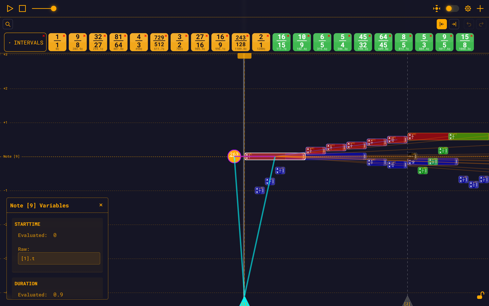

# RMT Compose

RMT Compose is a browser instrument for writing music in relationships. A pitch can be a fifth above another pitch. A phrase can begin when another ends. Change the note they follow and hear how the music moves.

**[Open the app](https://www.rmt.world/) · [Make your first change](docs/getting-started/first-composition.md) · [Documentation](https://docs.rmt.world/)**



## Listen to the canon

Press **Play**. A second bass voice answers the first one bar later. Press **Stop** to return to the opening. If the app reopened your own piece, use **+ → Save Module** to download it, then **+ → Load Module ▾ → Reset Default Module → Yes, Reset**.

Select a blue bass note and look at the frequency, start and duration in its widget. Each field can follow a different note. In bar 5 the green A (startup note 81) takes its pitch from the *following* E, a fifth above it. This lets the composer tune a passage toward its resolution. The [canon and cadences tutorial](docs/tutorials/workflows/canon-and-cadences.md) traces that choice and follows the voices in the revoiced **V7 – I**.

| Expression | What you hear |
|---|---|
| `base.f * (3/2)` in Frequency | A just fifth above the BaseNote |
| `[1].t + [1].d` in Start time | An entrance when note 1 ends |
| `base.d * 2` in Duration | Two time units, 1.2 seconds at the canon’s written 100 BPM |
| `base.f * 2^(7/12)` in Frequency | A twelve-tone equal-tempered fifth above the BaseNote |

`base.d` is the BaseNote’s duration in seconds. Counting one unit per beat gives `60 / base.d` BPM. Ratios and representable symbolic powers stay exact in the score. The equal-tempered fifth above is irrational and exact. An explicit `~` number requests approximation. [Musical model](docs/getting-started/concepts.md) · [Expression syntax](docs/reference/expressions/syntax.md)

## Compose and keep a version

- To change a relationship, edit the note’s **Raw** expression and press **Save** in that row. Replay the passage and use **Undo** to compare. [First composition](docs/getting-started/first-composition.md)
- Shift-drag across a phrase or use touch selection to work with notes and measure markers together. [Selection and group editing](docs/user-guide/notes/selection.md)
- Pull down the library and drop a progression onto the BaseNote or a note. Browse eight progressions and cadences, or try the complete canon and its two parts under **Custom**. [Module library](docs/user-guide/modules/module-library.md)
- **Save Module** downloads the editable score. Autosave resumes the current browser session. **Export MIDI** creates a performance for another instrument or DAW. [Saving and history](docs/user-guide/modules/saving-modules.md) · [MIDI export](docs/user-guide/modules/exporting-midi.md)

## What changed in v2

Hear the retuned canon and eight revoiced progressions, use a later pitch as a reference, and take the result into a DAW with pitch-bent MIDI. The [ranked release notes](docs/release-notes.md) cover the musical changes, editing, playback and large-score work since the published main version.

## Run locally

Use Node 20.19+ on the 20.x line or Node 22.12+ and a browser with WebGL2 and Web Audio.

```sh
npm ci
npm run dev
```

Open the address Vite prints (normally `http://localhost:3000`). From the repository root, `npm test` checks the application and shipped modules, `npm run build` builds the app and `npm run docs:build` builds the documentation. The two outputs deploy separately. [Developer setup](docs/developer/contributing/setup.md) · [Build and deployment](docs/developer/contributing/build-and-deploy.md) · [Measured performance and limits](docs/developer/performance.md)

## License

RMT Compose is released under the [MIT License](LICENSE.md), © 2026 Cyril Monkewitz. The samples, font and dependencies have their own [third-party notices](THIRD_PARTY_NOTICES.md).
